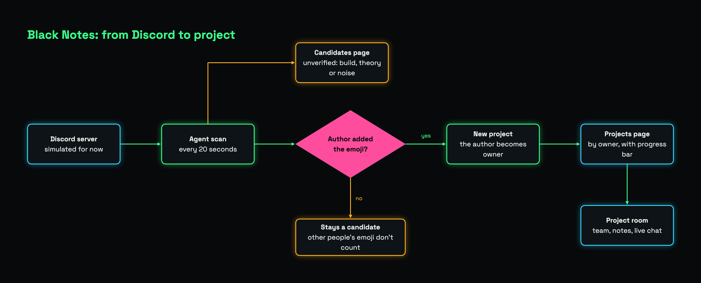
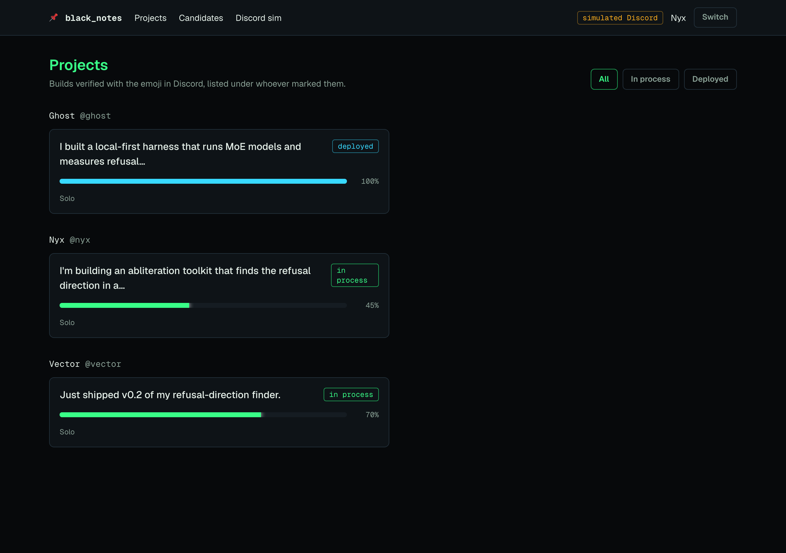
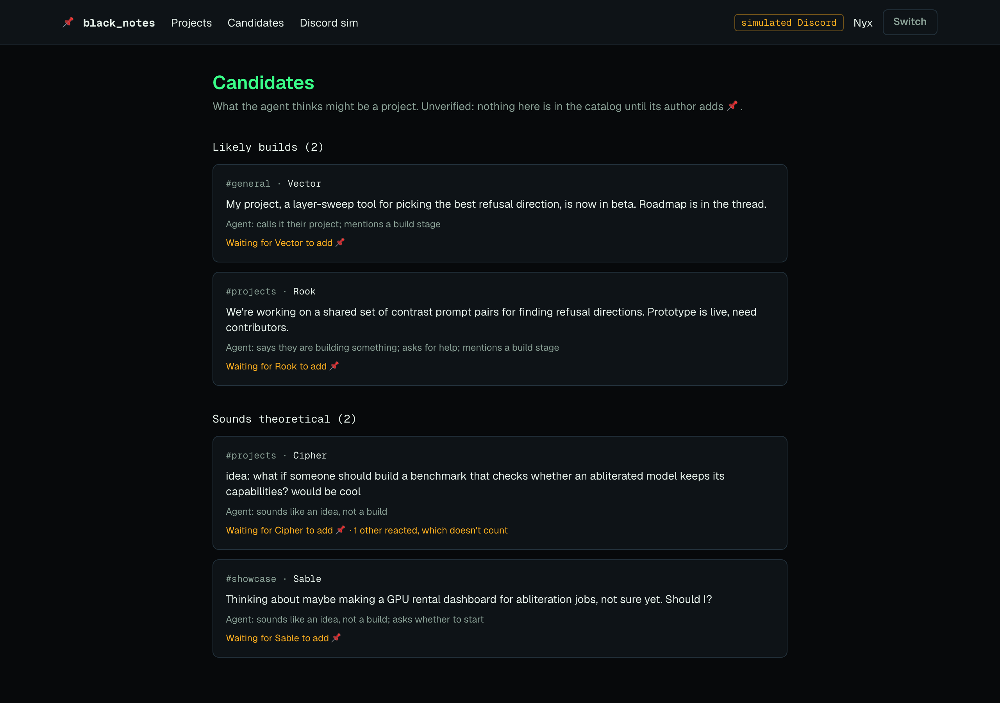
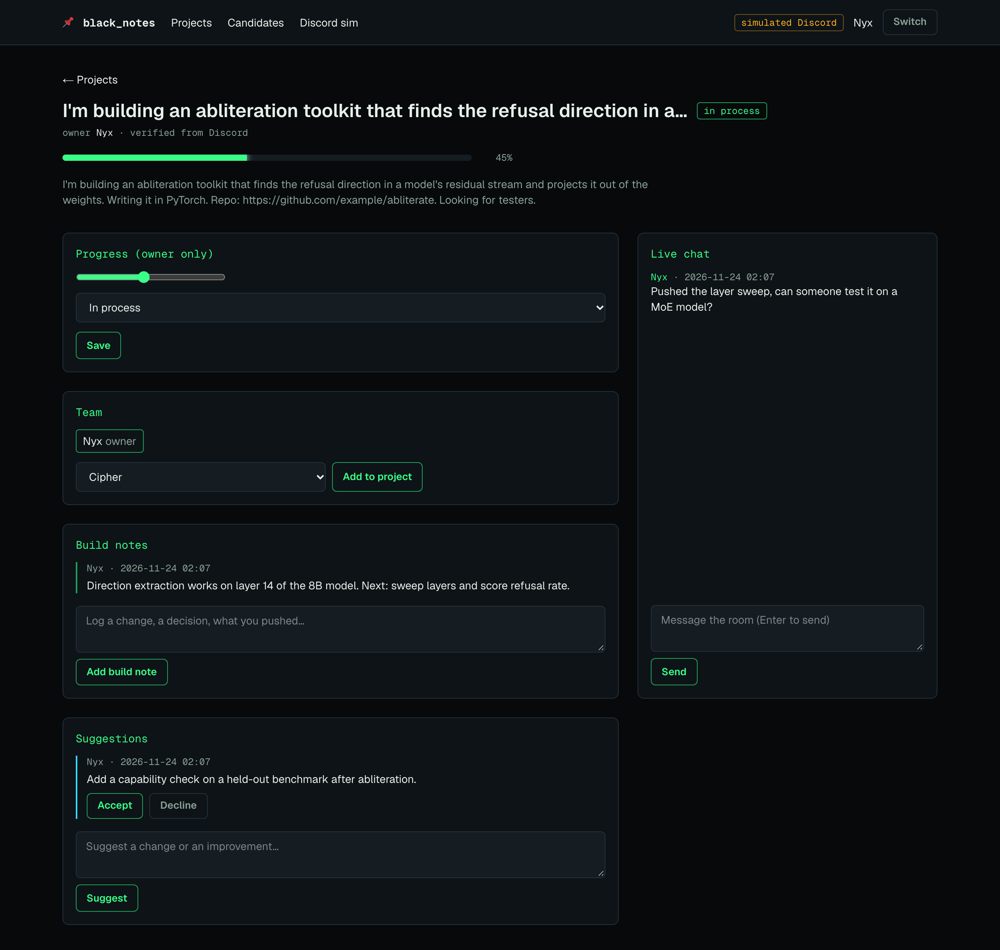
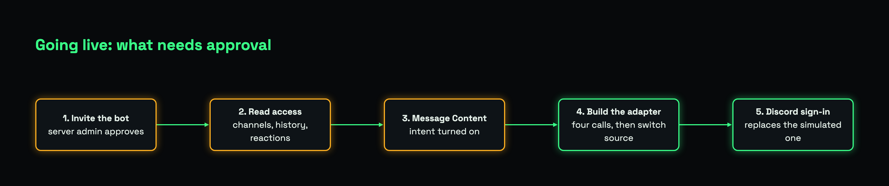

# Black Notes

A project board for a Discord community. An agent reads the server, spots posts that look like builds, and lists a project in the catalog once its author marks the post with a verify emoji. Each project has an owner, a progress bar, a small team the owner controls, build notes, suggestions and a live chat that extends the Discord conversation.



## How a project gets in

1. The agent scans channels and labels each message: likely build, theory, or noise.
2. Likely builds show on the **Candidates** page, unverified.
3. The **author** adds the verify emoji (a pin for now) to their message in Discord. A reaction from anyone else does nothing.
4. The message becomes a project under that author, who is its owner.

## What it looks like

All screenshots use made-up members and posts on a simulated Discord.

**Projects**: verified builds, grouped by owner, with status and progress.



**Candidates**: posts the agent thinks might be projects. Nothing here is in the catalog until its author adds the emoji, and a reaction from anyone else doesn't count.



**Project room**: owner-only progress and team, build notes, suggestions, and a live chat.



## Going live

What the server's owners would need to approve before the real bot can run:



Details are in [docs/how-it-works.md](docs/how-it-works.md).

## Status

Local prototype. Discord is **simulated** (a fake server with a `/discord` page to post and react). The real bot is not built and nothing connects to a real Discord server.

## Run it

Requires Node 24 or newer.

```bash
cd web
npm install
npm run dev
```

Open http://127.0.0.1:3001, then pick a simulated member to act as. Data lives in `web/data/` (not committed). Settings (all optional): `BLACK_NOTES_EMOJI`, `BLACK_NOTES_SOURCE`, `BLACK_NOTES_SCAN_SECONDS`.

## License

All rights reserved. See [LICENSE](LICENSE). Third-party code keeps its own license: see [NOTICES](NOTICES.md).
