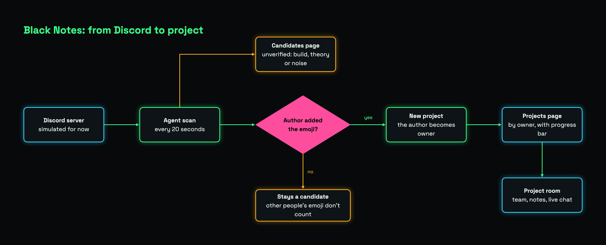
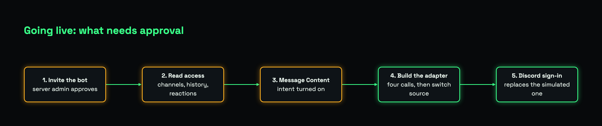

---
tags:
  - black-notes
  - how-it-works
created: 2026-11-20T21:17
updated: 2026-11-20T21:49
---
# How Black Notes works



## Simple view

An agent watches a Discord server. It spots posts that look like builds, but a post only becomes a project when its **author** puts the verify emoji on it. Projects are listed on a web page under their owner, with a progress bar.

```
 Discord server (simulated for now)
      |
      |  new messages + reactions
      v
 ---------------------------
 |  Agent scan (every 20s)  |
 ---------------------------
      |                \
      | label each      \  reaction = verify emoji
      | message          \  AND reactor = author ?
      v                   v
 likely build / theory / noise     YES -> new project, author = owner
      |                                   |
      v                                   v
 Candidates page (unverified)       Projects page (catalog)
                                          |
                                          v
                      Project room: progress, team, build notes,
                      suggestions, live chat
```

| Part | File | What it does |
| --- | --- | --- |
| Discord seam | `web/src/lib/discord/adapter.ts` | The one interface the app uses to read Discord: members, channels, messages, reactions |
| Simulated server | `web/src/lib/discord/mock.ts` | Fake server with seeded members and posts, plus the `/discord` page to post and react |
| Detector | `web/src/lib/detect.ts` | Keyword rules that label a message likely build, theory or noise |
| Agent | `web/src/lib/pipeline.ts` | Scan: pull new items, label them, verify, create projects |
| Timer | `web/src/instrumentation.ts` | Runs the scan on an interval while the server is up |
| Data | `web/src/lib/db.ts` | SQLite tables (built-in `node:sqlite`) |
| Sign-in and rules | `web/src/lib/auth.ts` | Session by Discord id; owner and delegate checks |
| Actions | `web/src/app/actions.ts` | Every write, each one re-checked on the server |
| Live updates | `web/src/lib/events.ts`, `web/src/app/events/route.ts` | Server-sent events refresh open pages instantly |
| Pages | `web/src/app/**` | Catalog, Candidates, Discord sim, project room |

### Who can do what

| Action | Who |
| --- | --- |
| See the catalog, candidates and any project | Any signed-in member |
| Verify a project | Its author only, by adding the emoji in Discord |
| Set progress and status | Owner only |
| Add or remove team members | Owner only (for now) |
| Write build notes | Owner and added team members |
| Post suggestions and chat | Any signed-in member |
| Accept or decline a suggestion | Owner only |

### Rebuild from scratch

1. Install Node 24 or newer.
2. Create a Next.js 16 app (App Router, TypeScript, Tailwind 4). Pin `next` 16.4.2, `react` 19.3.0.
3. No database server and no extra packages: storage is Node's built-in `node:sqlite`.
4. Add the files in the table above. Start with `db.ts`, then the adapter and mock, `detect.ts`, `pipeline.ts`, then pages.
5. `npm run dev` serves on 127.0.0.1:3001. Data goes to `web/data/` (not committed).
6. Optional settings: `BLACK_NOTES_EMOJI`, `BLACK_NOTES_SOURCE`, `BLACK_NOTES_SCAN_SECONDS`.

## Advanced view

### Scan, in order
1. Upsert members and channels from the source.
2. Fetch messages with `seq` above the stored cursor. Insert each with `INSERT OR IGNORE` and the detector's verdict, score and reason. Move the cursor.
3. Same for reactions.
4. **Verify:** select messages that have a reaction from their own author, are not already projects, and whose emoji matches the setting. Insert a project (`message_id` is UNIQUE, so repeats are no-ops), owner = author, title = first sentence (links removed, 80 characters max), summary = first 600 characters. Mark the message `project`.
5. All of the above is one SQLite transaction. A failure rolls it back.

### Detector rules (`detect.ts`)
Positive hits add points: "I'm building / working on" +3, "I built / shipped" +3, "just shipped" +2, "my project/tool/bot" +2, a repo link +2, "looking for testers/help" +2, a build-stage word (beta, demo, roadmap, v1.2) +1. Theory phrases subtract: "idea / what if / someone should / maybe / not sure yet" −3, "should I" −2. Score 3 or more is a **likely build**. Any positive or negative hit below that is **theory**. No hits is **noise**. The detector only decides what to show. It cannot create a project.

### The emoji
Set by `BLACK_NOTES_EMOJI`, default a pin (📌). Unicode emoji match as-is. A custom Discord emoji would be configured as `name:id` and matched by id. Removing the emoji later does **not** delete the project (the owner archives it; not built yet).

### Ownership and access
Identity is a Discord user id. Locally, sign-in picks a simulated member. The real site would use Discord OAuth and yield the same id. Sessions are a random token in an httpOnly cookie (only its SHA-256 is stored), 14 days. The author of every note and message comes from the session, never the form. Every action checks its rule on the server. Projects that don't exist return 404.

### Live updates
Open pages hold a server-sent-event connection (`/events` or `/events?project=<id>`). When anyone posts or changes something the server publishes on an in-process bus and every open page refreshes. Single server only.

### What the real bot needs (for approval)



- A Discord application and bot invited to the server by someone with permission.
- Permissions: view channels, read message history, and read reactions.
- The privileged **Message Content** intent, enabled in the developer portal, so the bot can read message text.
- Implement the four calls in `adapter.ts`, set `BLACK_NOTES_SOURCE=discord`, and replace the simulated sign-in with Discord OAuth.
- Optional AI-assisted detection stays off unless approved: message text would be sent to an outside API.
